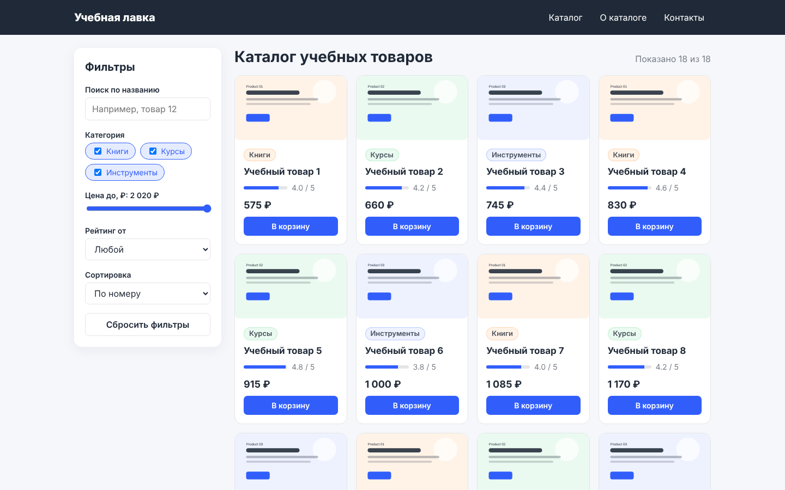

# Практическая работа №2 — «Учебная лавка»

**CSS, адаптивная вёрстка и SCSS. Организация стилей**

Адаптивный каталог учебных товаров: панель фильтров, сетка из 18 карточек, информационный блок со сводкой и подвал. Карточки строятся из `data/catalog.csv`, цвета, радиус и шаг отступов берутся из `data/theme.json` и попадают в SCSS-переменные. На широком экране фильтры стоят слева, а карточки идут в 4 колонки. На планшете панель переносится над карточками, на телефоне остаются 2 колонки, на 320 px — одна.

**Технологии:** HTML5, CSS Grid и Flexbox, Sass (SCSS, модули `@use`/`@forward`), JavaScript без библиотек.



## Требования к окружению

- Node.js 18+ и npm — для сборки SCSS (`sass` ставится как devDependency).
- Любой браузер последних версий.
- Локальный HTTP-сервер: страница загружает `catalog.csv` через `fetch`, а при открытии `index.html` двойным щелчком (`file://`) браузер запрещает такую загрузку.

## Запуск с нуля

```bash
git clone <ссылка-на-репозиторий> trpo-pr02-student
cd trpo-pr02-student
npm install          # ставит sass
npm run build        # theme.json -> _theme.scss, затем scss/styles.scss -> css/styles.css
npm start            # http://localhost:5173
```

Без Node.js можно запустить сервер Python: `python -m http.server 5173`. Готовый `css/styles.css` уже лежит в репозитории.

| Команда | Что делает |
| --- | --- |
| `npm run build` | Разовая сборка: `sass scss/styles.scss css/styles.css --no-source-map` |
| `npm run watch` | Режим наблюдения: пересобирает CSS при каждом сохранении `.scss` |
| `npm run theme` | Только пересоздаёт `scss/abstracts/_theme.scss` из `data/theme.json` |
| `npm start` | Локальный сервер на порту 5173 |

## Структура проекта

```
trpo-pr02-student/
├── index.html                 разметка: шапка, фильтры, каталог, инфоблок, подвал
├── data/
│   ├── catalog.csv            18 товаров (id; name; category; price; rating)
│   └── theme.json             цвета, радиус, шаг отступов
├── images/product-0N.svg      иллюстрации категорий из dataset/assets
├── js/catalog.js              загрузка CSV, фильтры, отрисовка карточек
├── scripts/build-theme.mjs    генерация SCSS-переменных из theme.json
├── scss/
│   ├── styles.scss            главный файл, подключает остальные части
│   ├── abstracts/             _theme (генерируется), _variables, _functions, _mixins, _index
│   ├── base/_base.scss        сброс, типографика, CSS custom properties
│   ├── layout/_layout.scss    шапка, сетка страницы, подвал, breakpoints раскладки
│   └── components/            _button, _badge, _filters, _product-card, _info, _states
├── css/styles.css             скомпилированный CSS
└── docs/                      результаты проверки и скриншоты
```

## Как используется dataset

| Файл | Где используется |
| --- | --- |
| `data/catalog.csv` | `js/catalog.js` → `parseCatalog()`: каждая строка превращается в карточку. Из данных строятся чекбоксы категорий, границы ползунка цены и сводка в блоке «О каталоге». `id` — устойчивый идентификатор (`data-id`, сортировка по умолчанию), `name` — только для вывода. |
| `data/theme.json` | `scripts/build-theme.mjs` создаёт `scss/abstracts/_theme.scss`, а `_variables.scss` присваивает значения переменным `$accent`, `$surface`, `$background`, `$text`, `$radius`, `$space`. Значения не дублируются вручную. |
| `images/product-01…03.svg` | Изображение карточки по категории: Книги → 01, Курсы → 02, Инструменты → 03. Фоновые цвета SVG стали картой `$category-colors` для badge. |

**Маршрут данных:** `catalog.csv` → `fetch()` → `parseCatalog()` (проверка колонок и значений) → `state.products` → `applyFilters()` (категория, цена, рейтинг, поиск, сортировка) → `createCard()` из `<template>` → `#catalog-grid`.

## Что изменилось по шагам

- **Шаг 5 — обычный CSS.** Сначала сделана рабочая раскладка без препроцессора (коммит `9d08dfa`). Значения цветов и отступов там повторялись вручную.
- **Шаги 6–7 — перенос в SCSS.** Стили разделены на `abstracts`, `base`, `layout`, `components`; `styles.scss` подключает их через `@use`. Переменные заданы для цветов, отступов (`$space`), радиусов (`$radius`, `$radius-small`, `$radius-pill`) и ширины контейнера (`$container-width`).
- **Шаг 8 — вложенность.** BEM-элементы описаны через `&__title`, `&--ghost`, `&:hover` внутри блока. Самая глубокая цепочка — три уровня: `.site-nav` → `&__link` → `&:hover`. В CSS селекторы остались плоскими (`.site-nav__link:hover`), без лишней специфичности.
- **Шаг 9 — mixin-ы** (`scss/abstracts/_mixins.scss`):
  - `container` — ширина и поля контейнера. Используется в шапке, основной сетке и подвале.
  - `focus-ring` — видимый фокус для клавиатуры у ссылок, кнопок и полей.
  - `panel` — белая панель с радиусом и тенью для фильтров, инфоблока и состояний.
  - `respond-to($bp)` — медиазапрос по переменной-breakpoint.
- **Шаг 10 — функции** (`scss/abstracts/_functions.scss`). `rem($px)` переводит пиксели в rem через `math.div`. `space($n)` возвращает отступ, кратный шагу из theme.json: `space(1.5)` = 1.5rem. Производные цвета (`$text-muted`, `$border`, `$accent-soft`, `$accent-hover`) считаются встроенными `color.mix` и `color.adjust`. Модификаторы `.badge--books/--courses/--tools` генерируются циклом `@each` по карте.
- **Шаг 12 — сетка карточек.** `grid-template-columns: repeat(auto-fill, minmax($card-min-width, 1fr))`. Число колонок меняется само: 4 на 1440 px, 3 на 768 px, 2 на 375 px, 1 на 320 px.
- **Шаг 13 — два breakpoint.**
  - `$bp-tablet: 768px` — перестройка раскладки: фильтры над карточками, поля фильтра в 2 колонки.
  - `$bp-mobile: 480px` — плотность и навигация: минимальная ширина карточки 160 px, меньше отступов и шрифт. Меню уходит под логотип и растягивается на всю ширину.

## SCSS-переменная и CSS custom property

| | SCSS-переменная `$accent` | CSS custom property `--rating` |
| --- | --- | --- |
| Когда существует | Только при компиляции; в `css/styles.css` её нет, вместо неё подставлено значение `#315efb` | В браузере, во время работы страницы |
| Можно ли менять из JS | Нет | Да: `style.setProperty('--rating', 4.2)` |
| Каскад и наследование | Нет, лексическая область видимости в SCSS | Да, наследуется по DOM |
| Где в проекте | Цвета, отступы, радиусы, breakpoints | `--rating` задаёт ширину полоски рейтинга каждой карточки. `--color-accent` выводится в `:root` для отладки в DevTools |

**Зачем partial-файлы.** Файлы с `_` в начале имени не компилируются отдельно, а подключаются в `styles.scss`. Каждый файл отвечает за одну часть интерфейса, переменные лежат в одном месте, а модульная система `@use` не даёт случайно продублировать CSS.

## Проверка и состояния интерфейса

Проверено в Chromium на ширинах 375, 768 и 1440 px. Горизонтальной прокрутки нет (`scrollWidth = clientWidth`), ошибок в Console нет. Подробности и скриншоты — в [docs/checks.md](docs/checks.md).

| Сценарий | Результат |
| --- | --- |
| Фильтр ничего не нашёл (поиск «несуществующий») | Блок «Ничего не найдено» с кнопкой сброса |
| `catalog.csv` недоступен (404) или страница открыта как `file://` | Блок «Не удалось загрузить каталог» с причиной, фильтры отключаются |
| В CSV нет нужной колонки или строка некорректна | Ошибка с названием колонки; некорректные строки пропускаются и считаются в сводке |

**Короткий сценарий проверки:**
1. `npm run build && npm start`, открыть http://localhost:5173.
2. Убедиться, что показано 18 из 18.
3. Снять «Курсы» — останется 12. Рейтинг «4.8» — 0 и пустое состояние. «Сбросить фильтры» — снова 18.
4. В DevTools → Responsive проверить 375, 768 и 1440 px.
5. Поменять `"accent"` в `data/theme.json` и выполнить `npm run build`: цвет кнопок, полосок рейтинга и фокуса сменится везде.
