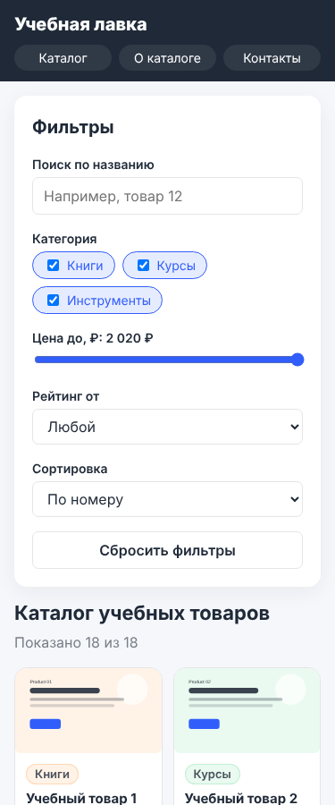
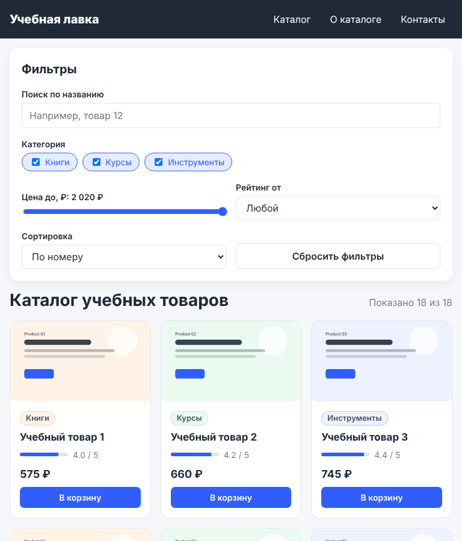
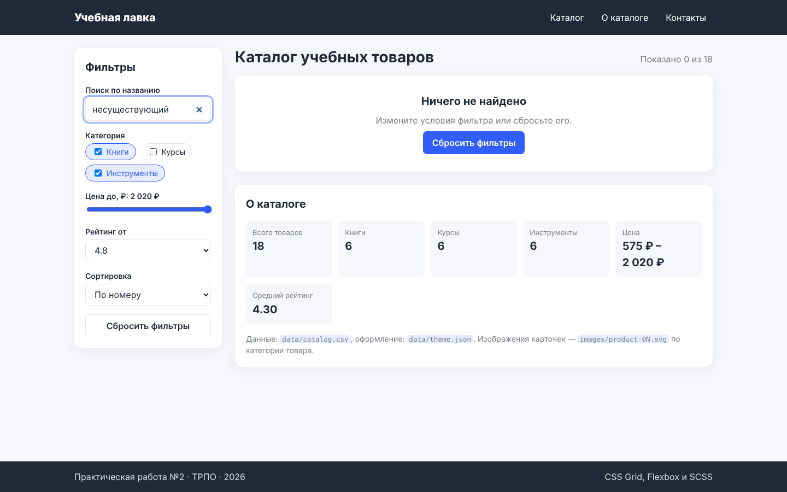
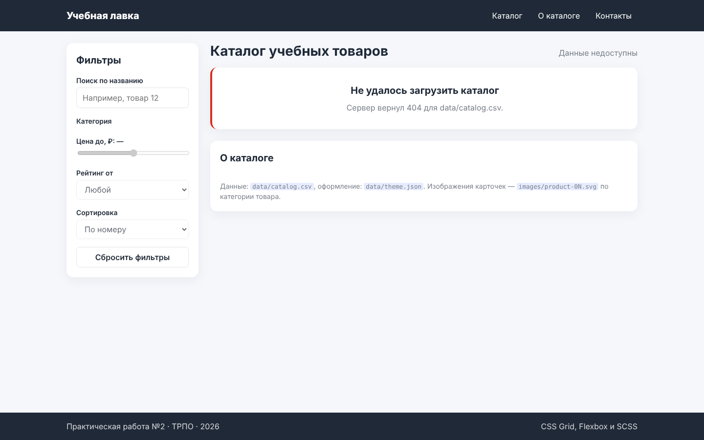

# Проверка адаптивности и состояний

Проверено в Chromium (DevTools Responsive Mode / Playwright), страница открыта через локальный сервер.

| Ширина | Раскладка | Колонок карточек | Горизонтальный скролл | Ошибки Console |
| --- | --- | --- | --- | --- |
| 1440 px | Фильтры слева (270 px), каталог справа | 4 | нет (1440 = 1440) | нет |
| 768 px | Фильтры над каталогом, поля в 2 колонки | 3 | нет (768 = 768) | нет |
| 375 px | Меню под логотипом, поля в 1 колонку, плотные карточки | 2 | нет (375 = 375) | нет |

Как проверялось отсутствие скролла: в Console `document.documentElement.scrollWidth === document.documentElement.clientWidth` → `true` на каждой ширине.

## Функциональные сценарии

| Действие | Ожидание | Факт |
| --- | --- | --- |
| Загрузка страницы | 18 карточек из catalog.csv | «Показано 18 из 18» |
| Снять категорию «Курсы» | 12 карточек | 12 |
| + рейтинг от 4.8 | 0, пустое состояние | 0, блок «Ничего не найдено» |
| Кнопка «Сбросить фильтры» | 18 карточек, все категории отмечены | 18 |
| Сортировка «Сначала дороже» | Первая цена 2 020 ₽ | 2 020 ₽ |
| catalog.csv отвечает 404 | Сообщение об ошибке, фильтры отключены | «Сервер вернул 404 для data/catalog.csv.» |

## Скриншоты

| 375 px | 768 px |
| --- | --- |
|  |  |

| Пустое состояние | Ошибка загрузки |
| --- | --- |
|  |  |
