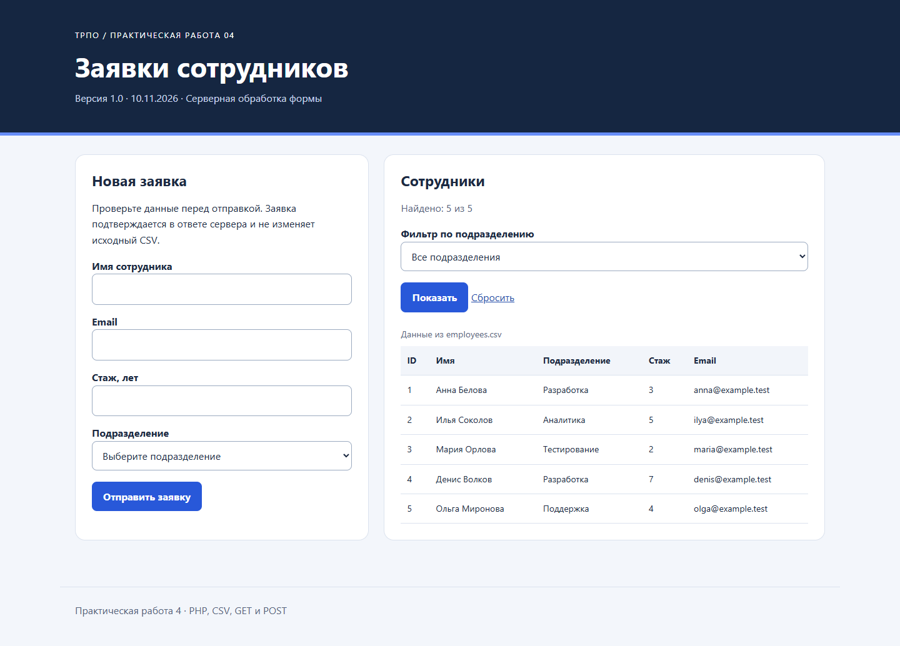

# Практическая работа 4 — заявки сотрудников

PHP-приложение читает пять сотрудников из CSV, фильтрует их по подразделению и обрабатывает заявку из четырёх полей. При ошибке показывает сообщения возле полей и сохраняет безопасные введённые значения. При успехе выводит подтверждение. Новая заявка не записывается в CSV: постоянное хранение появляется в работе 6.

## Запуск с нуля

Нужны Git, браузер и PHP 8.1+ с JSON, session и filter (обычная CLI-сборка). Composer, Node.js и Apache для этой работы не нужны.

```bash
git clone https://github.com/Toxic-005/trpo-pr02-student.git
cd trpo-pr02-student
php -S localhost:8004 -t pr04/public
```

Откройте http://localhost:8004/index.php. Остановить сервер: Ctrl+C. Не открывайте PHP двойным щелчком. Корень сервера — только `public`, чтобы исходные данные не раздавались посетителям.

Ошибки отображаются только при `APP_ENV=development`. Для PowerShell перед запуском: `$env:APP_ENV='development'`; для Linux/macOS: `APP_ENV=development php -S localhost:8004 -t pr04/public`. Без этой настройки приложение скрывает технические сообщения. На странице версия и дата формируются PHP; часовой пояс — Europe/Moscow.

## Структура и данные

```text
pr04/
  public/index.php       запрос, форма и таблица без MVC
  public/styles.css      адаптивное оформление
  src/functions.php      нормализация, CSV, валидация и фильтр
  data/employees.csv     исходные сотрудники, читается при каждом запросе
  data/form_cases.json   сценарии, выполняются tests/run.php
  tests/run.php          проверки без сторонних библиотек
  docs/checks.md         результаты и сценарий защиты
```

`loadEmployees()` использует `fgetcsv` с разделителем `;`, проверяет заголовок и убирает UTF-8 BOM из первого столбца. `normalizeEmployee()` преобразует `id` и `experience` в int, остальные поля — в строки. Идентификатор не зависит от имени сотрудника.

Путь запроса: `$_POST` → `normalizeInput()` и `trim()` → `validateInput()` → массив ошибок либо подтверждение → `e()` → HTML. Массив вместо строкового параметра превращается в пустую строку без warning. Функции подключаются через `require_once`.

Правила: имя 1–100 Unicode-символов после trim; email проходит `FILTER_VALIDATE_EMAIL` и ограничен 254 байтами; подразделение выбирается из CSV; стаж — целое число 0–60. Четыре поля: имя, email, стаж и подразделение. Клиентская проверка не заменяет серверную; `novalidate` позволяет увидеть её сообщения.

## GET, POST и безопасный вывод

GET используется для чтения и фильтра: `index.php?department=Разработка`, адрес можно сохранить и повторить. POST передаёт заявку в теле запроса и выполняет обработку. POST сам по себе не шифрует данные: при размещении нужен HTTPS.

`htmlspecialchars` в `e()` заменяет HTML-значимые символы; строка `<script>` становится текстом. Это защита вывода в HTML, а не проверка email и не замена валидации.

В интерфейсе осмысленно используются string `$version`, int `$maxExperience`, bool `$showTable` и массив сотрудников. После шага 12 загрузка и валидация выделены в функции; после шага 13 добавлен независимый GET-фильтр. Неизвестное подразделение даёт пустое состояние; отсутствие фильтра показывает все пять записей.

## Проверка

Из корня репозитория:

```bash
php pr04/tests/run.php
```

18 проверок: все случаи из `form_cases.json`, границы стажа, длина имени, пробелы, email, массивы вместо строк, экранирование и фильтрация. Для случаев dataset подставляются корректные email и подразделение, поскольку JSON проверяет только имя и стаж. HTTP-сценарии и снимки — в [docs/checks.md](docs/checks.md).

1. Открыть страницу: видны пять сотрудников.
2. Выбрать «Разработка»: останутся Анна и Денис; сброс вернёт всех.
3. Отправить пустые поля, неверный email и стаж −2: появятся сообщения.
4. Ввести Иван, `ivan@example.test`, 4, «Разработка»: появится подтверждение.
5. Передать в имени `<script>alert(1)</script>`: текст отобразится без выполнения.



## Для защиты

Сервер выполняет PHP до отправки HTML, JavaScript выполняется браузером после загрузки. Обработку строки CSV меняют в `normalizeEmployee`, правила формы — в `validateInput`, разметку — в `public/index.php`. При росте приложения следует разделить обработчик и шаблоны и добавить хранилище заявок. `data` — копия dataset текущей работы; все файлы используются приложением или тестами.
