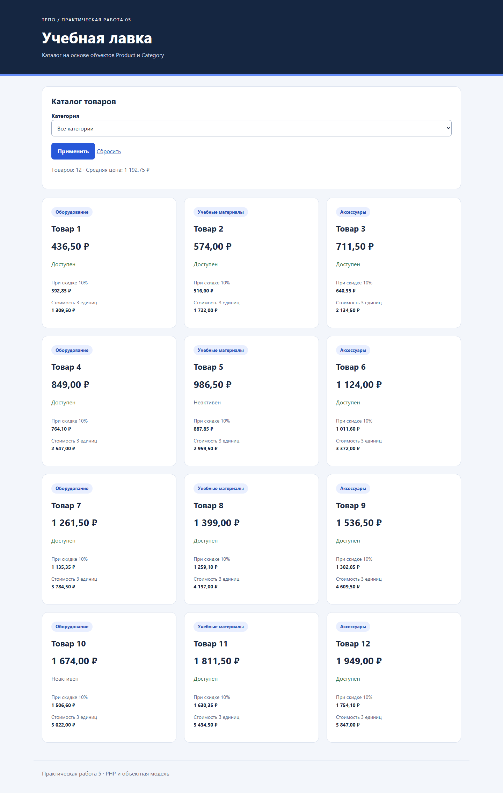

# Практическая работа 5 — объектный каталог

Каталог формирует карточки всех 12 товаров из JSON, связывает их с тремя категориями, фильтрует по категории и считает среднюю цену. Неактивные товары остаются видимыми с соответствующим статусом. Модели не содержат HTML.

## Запуск с нуля

Нужны PHP 8.1+ (обычная CLI-сборка с JSON и filter), Git и браузер. Composer и npm не нужны.

```bash
git clone https://github.com/Toxic-005/trpo-pr02-student.git
cd trpo-pr02-student
php -S localhost:8005 -t pr05/public
```

Откройте http://localhost:8005/index.php. Остановка: Ctrl+C. Запускайте только `public` как корень сервера. При уже скачанном репозитории начните с последней команды из его корня.

Технические ошибки видимы только при `APP_ENV=development`: в PowerShell `$env:APP_ENV='development'` перед запуском; в Linux/macOS `APP_ENV=development php -S localhost:8005 -t pr05/public`.

## Объектная модель

```text
data/products.json ──┐
                    ├─> CatalogService ─> Product[] ─> public/index.php ─> HTML
data/categories.json┘          └─────────> Category[]

Product → CatalogService → index.php
```

`Product` описывает один товар и проверяет инварианты в конструкторе. `Category` описывает связанную категорию. `CatalogService` читает JSON, создаёт объекты, проверяет ссылки и повторяющиеся id, фильтрует коллекцию и вычисляет среднее. `index.php` получает GET-параметр и отображает объекты, экранируя значения перед выводом.

```text
public/index.php, styles.css  обработка фильтра и карточки
src/Model/Product.php        товар с закрытыми типизированными свойствами
src/Model/Category.php       категория
src/Service/CatalogService.php загрузка и операции коллекции
data/                        копия dataset работы 5
tests/run.php                тесты модели и CSV-контракта
docs/                        результаты и скриншоты
```

Свойства из `class_requirements.csv`: у Product — `id: int`, `name: string`, `price: float`, `categoryId: int`; у Category — `id: int`, `name: string`. В тестах CSV читается через `fgetcsv`, а Reflection проверяет наличие, закрытость и тип каждого свойства. Это проверяемый контракт, а не неиспользуемая копия файла. Поле JSON `category_id` преобразуется в свойство `categoryId`.

Дополнительное свойство Product `active: bool` отражает поле исходного JSON. Отсутствующее или null-значение необязательного `active` означает true; обязательные поля не допускают пустых значений. Все 12 исходных строк, включая два неактивных товара, отображаются. Цена форматируется в представлении, хранится как float согласно CSV.

Четыре предметных метода Product:

| Метод | Назначение |
| --- | --- |
| `isAvailable()` | Статус доступности по active |
| `belongsToCategory(int)` | Принадлежность категории |
| `priceForQuantity(int)` | Стоимость 1–1000 единиц |
| `discountedPrice(float)` | Цена со скидкой 0–100% |

В карточках видны обычная цена, цена со скидкой 10% и стоимость трёх единиц. Фильтр использует `belongsToCategory`, статус — `isAvailable`. Методы чтения нужны шаблону; они не заменяют предметное поведение.

`new Product(1, 'Товар', -1.0, 1)` выбрасывает `InvalidArgumentException`: отрицательная цена не может стать состоянием объекта. Конструктор проверяет положительные id, непустое название и конечную неотрицательную цену. Нулевая цена допустима. Неизвестная категория в данных и повреждённый JSON дают понятную ошибку с HTTP 503.

`CatalogService::filterByCategory(null)` возвращает все товары; неизвестный положительный id — пустой список; некорректный GET-параметр — HTTP 400. `averagePrice([])` возвращает 0.00, для всех исходных товаров среднее равно 1 192,75 ₽.

Классы подключаются через `require_once`. При росте проекта список ручных подключений становится длинным, зависит от порядка и путей; следующим шагом может быть автозагрузка PSR-4 через Composer. Полный MVC в этой работе не используется.

## Проверка

```bash
php pr05/tests/run.php
```

36 проверок: все товары и категории, средняя цена, пустая выборка, CSV-контракт, некорректные конструкторы, скидка, количество и необязательный active.

1. На главной видны 12 карточек, два статуса «Неактивен», средняя 1 192,75 ₽.
2. Выбрать категорию «Аксессуары»: останется четыре карточки.
3. Открыть `index.php?category=999`: пустое состояние.
4. Открыть `index.php?category[]=1`: сообщение о неверном параметре и HTTP 400.
5. Запустить tests/run.php и показать отклонение отрицательной цены.

Подробности — в [docs/checks.md](docs/checks.md).



## Для защиты

Чтобы добавить, например, остаток товара, нужно определить его смысл, добавить аргумент конструктора и проверку, загрузить поле в сервисе, добавить предметный метод и отобразить результат. Менять форматирование цены внутри модели не требуется: оно находится в `money()` представления. Для больших каталогов чтение всего JSON при каждом запросе следует заменить запросами к базе данных.
