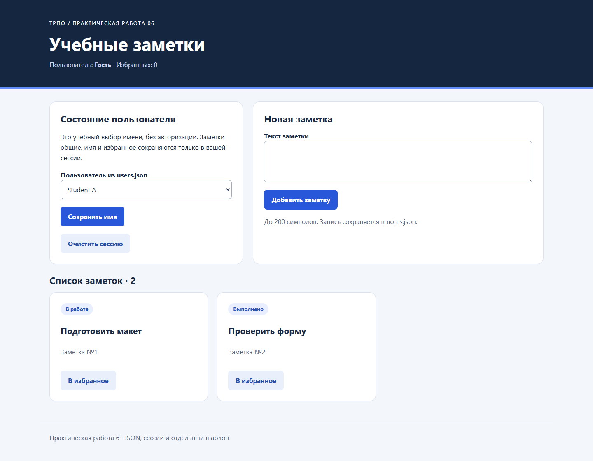

# Практическая работа 6 — заметки и сессии

Список заметок читает и изменяет JSON, хранит выбранное имя и избранные id в PHP session и выводит отдельный HTML-шаблон. При успешном POST возвращает redirect 303. Неизвестное значение `page` открывает страницу 404.

## Запуск с нуля

Нужны Git, браузер и PHP 8.1+ с JSON и session (обычная CLI-сборка). Процесс PHP должен иметь право записи в `pr06/data/notes.json` и стандартный каталог хранения PHP-сессий. Зависимостей Composer/npm нет.

```bash
git clone https://github.com/Toxic-005/trpo-pr02-student.git
cd trpo-pr02-student
php -S localhost:8006 -t pr06/public
```

Откройте http://localhost:8006/index.php?page=list. Остановка сервера: Ctrl+C. Только `public` служит корнем HTTP-сервера: JSON и исходники снаружи этого каталога.

Технические сообщения включаются только при `APP_ENV=development`. В PowerShell: `$env:APP_ENV='development'` перед запуском, в Linux/macOS: `APP_ENV=development php -S localhost:8006 -t pr06/public`.

## Структура и маршрут запроса

```text
public/index.php        session_start, выбор страницы, POST и redirect
public/styles.css       оформление
src/functions.php       загрузка/запись JSON, сессия, render, экранирование
templates/list.php      HTML на основе подготовленных данных
templates/404.php       неизвестная страница
data/notes.json         общие постоянные заметки; меняется после добавления
data/users.json         список условных пользователей для выбора
data/session_scenarios.json сценарии, применяемые tests/run.php
tests/run.php           проверки на временном файле
docs/                   результаты и снимки
```

Все формы отправляются в `index.php?page=list`, все действия выполняются через эту точку входа. Пустой `page` равнозначен `list`; другой непустой параметр возвращает 404. `styles.css` — единственный вспомогательный публичный ресурс.

GET → `session_start` до HTML → `loadUsers` и `loadNotes` → подготовка массива данных → `render` → `templates/list.php`. Шаблон не читает файлы, не обращается к `$_POST` и не изменяет `$_SESSION`.

POST → проверка CSRF-токена → `action` → проверка текста/пользователя/id → изменение JSON или session → redirect 303 → новый GET. Поэтому обновление после успешного добавления не повторяет запись. При ошибке валидации возвращается 422 и сохраняется текст формы; неверный токен даёт 403. Все значения выводятся через `htmlspecialchars`.

## Файловое хранилище

`loadNotes()` читает файл через `file_get_contents` под общей блокировкой; `loadUsers()` также использует `file_get_contents`; общий `decodeList()` вызывает `json_decode` с `JSON_THROW_ON_ERROR`. Проверяются список, типы полей и уникальность id. Повреждённый, отсутствующий или структурно неверный notes.json приводит к HTTP 503 с сообщением, а не к необработанному fatal error. Файл не пересоздаётся автоматически: так повреждение не маскируется пустым списком.

`saveNotes()` берёт исключительную `flock` на весь цикл «прочитать → изменить → записать». `addNote()` выделяет `max(id)+1` внутри блокировки и добавляет `done=false`. Для пустого списка первый id — 1. Текст должен содержать 1–200 Unicode-символов после trim. Запись защищена от потери параллельного добавления при использовании тех же функций и блокировок.

Файл данных действительно меняется. Перед восстановлением исходного `notes.json` сохраните нужные заметки: восстановление из Git удалит локальные добавления. Тесты PHP работают с временной копией и не меняют учебные данные.

Ограничения: весь JSON читается в память; запись не является транзакцией базы данных и может пострадать при аварии диска/процесса; `flock` требует совместимого локального хранилища и соблюдения блокировок всеми писателями. Для большого или многосерверного проекта нужны база данных, транзакции, резервное копирование и полноценная авторизация.

## Сессия

`$_SESSION['display_name']` хранит имя, `favorites` — только id избранных заметок. Исходные заметки и пользователи берутся из JSON. Выбор имени — учебное состояние, не вход в защищённую учётную запись. Кнопка очистки удаляет имя и избранное; заметки остаются в файле. После смены/очистки имени идентификатор session обновляется.

В обычных вкладках одного браузерного профиля cookie сессии общий, поэтому имя и избранное совпадают. Приватный контекст имеет отдельное cookie-хранилище: первоначально он показывает «Гость». Изменение notes.json видно обоим контекстам, так как это общие данные. Приватные окна одного приватного профиля могут разделять сессию между собой. Состояние живёт до истечения/удаления сессии и cookie, а не бессрочно.

## Проверка

```bash
php pr06/tests/run.php
```

15 проверок: все `session_scenarios.json` (`new_session`, `set_name`, `clear`), сохранение заметок, id, trim, ограничения текста, повреждённый/отсутствующий JSON и пустой список. Начальные notes/users — копия dataset; сценарии реально читаются тестом.

1. Открыть страницу: две заметки, пользователь «Гость».
2. Выбрать Student A и обновить страницу: имя сохранено.
3. Открыть адрес в приватном контексте: «Гость», те же заметки.
4. Добавить заметку и обновить страницу: новая запись одна, JSON изменён.
5. Добавить заметку в избранное, обновить: выбор сохранён в текущей сессии.
6. Очистить сессию: «Гость» и ноль избранных; файл не меняется.
7. `index.php?page=unknown`: страница 404.
8. На резервной копии проекта испортить/временно переименовать notes.json: понятное сообщение и 503. Затем восстановить файл.

Фактические результаты — в [docs/checks.md](docs/checks.md).



## Для защиты

JSON хранит долговременные общие данные, session — состояние конкретного посетителя; эти механизмы не взаимозаменяемы. Функция `render` передаёт массив в область видимости шаблона через `extract(..., EXTR_SKIP)`. Путь шаблона задаётся кодом, а не входным параметром. Это подготовка к MVC: при дальнейшем росте выбор маршрута и обработчики можно перенести в отдельные классы.
