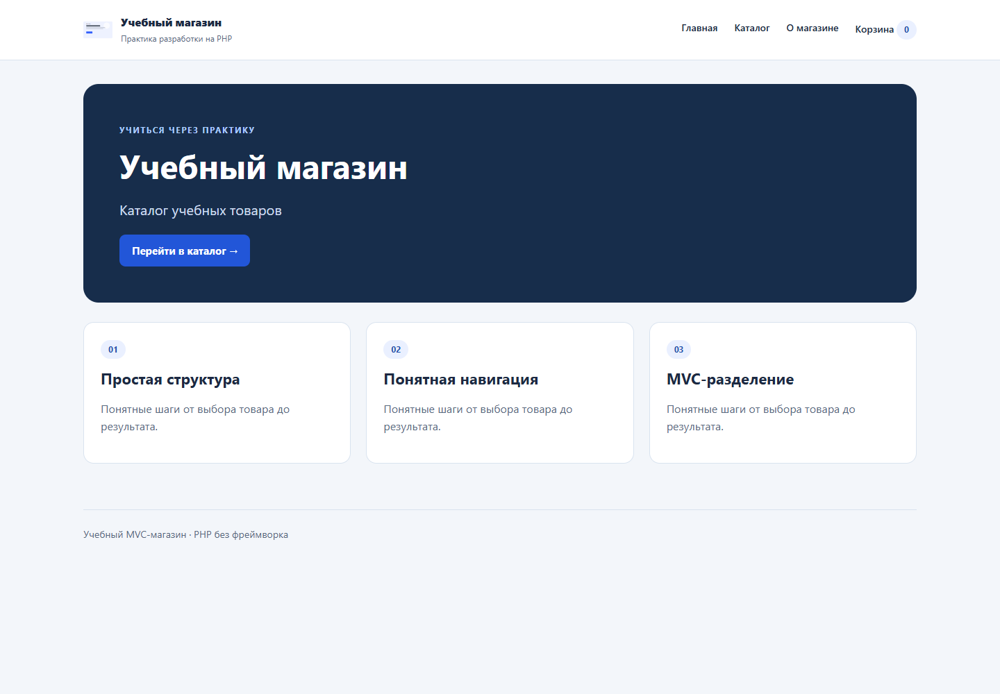

# MVC-магазин — практические работы 7–11

Учебный интернет-магазин без фреймворка: главная, каталог из JSON, карточка товара, корзина в session и сохранение заказа. Работы 7–11 последовательно развивают один проект в указанном репозитории; предыдущие работы в корне и папках pr04–pr06 сохранены. Основой главной служит `data/pr07/pages.json`, логотип скопирован из dataset.

Нужны Git, PHP 8.1+ с JSON, session и filter (обычная CLI-сборка) и браузер. Для дополнительных HTTP-тестов нужен Node.js 18+. Composer и npm для запуска магазина не нужны. Чистый запуск:

```bash
git clone https://github.com/Toxic-005/trpo-pr02-student.git
cd trpo-pr02-student
```

Из корня репозитория:

```bash
php -S localhost:8007 -t shop/public shop/public/router.php
```

Откройте http://localhost:8007. Для остановки нажмите Ctrl+C. Не открывайте PHP двойным щелчком: сервер должен выполнить код. `router.php` — адаптер встроенного сервера; динамические запросы проходят через `index.php`. Он не содержит разметки. Только styles.css и shop-logo.svg выдаются как статические файлы. На GitHub Pages PHP не выполняется.

Хранилище `shop/storage` должно быть доступно PHP для записи; при чистом запуске в нём только .gitkeep. Режим разработки: PowerShell `$env:APP_ENV='development'` перед запуском; Linux/macOS `APP_ENV=development php -S localhost:8007 -t shop/public shop/public/router.php`. В обычном режиме детали неожиданных исключений скрыты; в локальном — показаны через общий шаблон ошибки, без сырого stack trace.

Этапы опубликованы как ветки `pr07`, `pr08`, `pr09`, `pr10`, а итог находится в main. В локальной истории этапы также отмечены Git-тегами. Перед работой 11 сохранена резервная ветка `before-pr11`. Итоговая версия — тег `shop-v1.0.0`. Для изучения промежуточного каркаса: `git switch pr07`; для возврата: `git switch main`. Команды запуска на всех этапах одинаковы.

| Маршрут из routes.csv | Контроллер | View | Статус |
| --- | --- | --- | --- |
| GET / | HomeController::index | home | 200 |
| GET /catalog | CatalogController::index | catalog | 200 |
| GET /about | HomeController::about | about | 200 |
| GET /missing | ErrorController::notFound | error | 404 |

Неизвестный адрес также даёт 404. Router выбирает callable, Controller передаёт данные в View, View компонует шаблон и общий layout. Конструкторы получают реальные зависимости. PHP-классы находятся в `src`, шаблоны — в `views`, исходные данные — в `data`. Работа 8 продолжает тот же магазин; промежуточный этап 7 сохранён отдельно.

## Работа 8

Тестовый массив заменён 24 товарами и четырьмя категориями из `data/pr08`. `ProductRepository` читает JSON и возвращает Product, который связан с Category объектной ссылкой. Дополнительное свойство stock — остаток. Цены хранятся в целых копейках, форматируются через `money()` перед отображением. В шаблонах нет чтения файлов и фильтрации.

Маршрут: `GET /catalog?category=1&sort=price` → Router → CatalogController → ProductRepository → Product[] → views/catalog.php → layout. Допустимы name, price, price_desc. Фильтр и сортировка сохраняются в URL. Неизвестная категория даёт пустое состояние. `GET /product/1` показывает карточку; неизвестный/нечисловой id возвращает 404.

Namespaces `Shop\Controller`, `Shop\Model`, `Shop\Repository` загружаются через `spl_autoload_register` из bootstrap. Ручных require классов в контроллерах нет. Product не знает HTTP, repository не знает HTML, а контроллер не открывает JSON.

Проверки из корня: `php shop/tests/catalog.php`. Все строки `catalog_cases.csv` реально выполняются: общий список, книги с сортировкой цены, неизвестная категория. Для ручной проверки откройте главную, каталог, категорию 1 и /product/99999.

## Работа 9

Перед добавлением корзины состояние каталога сохранено отдельным коммитом и веткой `pr08`. `GET /cart` показывает пустую или заполненную корзину. Изменения — только `POST /cart/add`, `/cart/set`, `/cart/remove`; после успеха redirect 302 на /cart. GET этих адресов возвращает 405 и ничего не меняет. Flash хранится до одного отображения.

Session запускается в bootstrap один раз. В `cart` лежат только id → количество, описания и цены берутся из ProductRepository. `CartService` не обращается к HTTP-глобальным переменным: принимает массив состояния и возвращает новый. Там же считаются суммы позиций, общий итог и число единиц. Контроллер читает Request, проверяет CSRF и сохраняет результат в SessionStore. Проверяются положительное целое количество 1–99 и доступный остаток; неизвестный id даёт 404. В layout отображается общий счётчик.

Набор №9 содержит другой каталог с теми же id. Для него предусмотрен режим `SHOP_CATALOG=cart` (PowerShell: `$env:SHOP_CATALOG='cart'` перед запуском). Он читает четыре товара из `data/pr09/products.json`; поскольку категории и остатки отсутствуют, адаптер назначает категорию «Контрольные товары» и учебный остаток 99. Основной режим продолжает использовать все 24 товара №8. Сессии двух режимов имеют разные имена cookies, чтобы не смешивать одинаковые id. Для возврата: PowerShell `Remove-Item Env:SHOP_CATALOG`; Linux/macOS — не задавать переменную.

`php shop/tests/cart.php` выполняет все последовательности cart_scenarios.json на исходном наборе №9 и сверяет состав, количество и суммы. В частности, два экземпляра книги и один курс дают 4 300 ₽; три клавиатуры — 12 900 ₽. Новая приватная сессия открывает пустую корзину. Обычные вкладки одного профиля делят cookie и корзину.

## Работа 10

`GET /checkout` показывает форму и состав корзины, `POST /checkout` валидирует данные и сохраняет заказ. Способы доставки читаются из `data/pr10/delivery_methods.json`. `OrderValidator` проверяет имя 1–100 символов, email до 254 байт, известный способ доставки, адрес 1–200 символов для курьера. Для самовывоза выбран фиксированный пункт выдачи, поэтому исходный корректный случай dataset не требует адреса. Ошибки возвращаются возле полей с HTTP 422, введённые значения безопасно сохраняются.

Последовательность: GET /checkout → CheckoutController → View; POST /checkout → CSRF → OrderValidator → CartService (цены и остатки) → OrderData → CheckoutService → OrderRepository → очистка корзины → redirect 302 /order/success?id=… → подтверждение. Объект OrderData создаётся только после валидации. Итог включает выбранную доставку (самовывоз 0 ₽, курьер 450 ₽).

Хранилище — `shop/storage/orders.json`, создаётся только после успешного POST из исходного `orders_seed.json`. Отдельная блокировка orders.lock охватывает чтение, выделение id и запись. Новый JSON сначала записывается во временный файл в том же каталоге, затем заменяет старый через rename. Повреждённое хранилище не заменяется пустым; ошибка не очищает корзину. Runtime-файлы исключены из Git. Для тестов можно задать `SHOP_STORAGE` с отдельным каталогом вне public.

Session хранит максимум десять кратких подтверждений (номер, сумма, доставка). Страница успеха проверяет принадлежность подтверждения текущей сессии и не показывает имя, email или адрес. Заказ другой сессии недоступен. Повторный POST после успешного заказа отклоняется из-за пустой корзины; обновление GET не создаёт дубликат.

Проверка: `php shop/tests/order.php` выполняет все order_cases.json, неизвестную доставку, курьера без адреса, сохранение JSON, итог с доставкой и отказ от перезаписи повреждённого файла. Для ручной проверки добавьте товар, откройте checkout, отправьте пустую форму, затем корректную. После успеха корзина пуста, в storage появляется запись. Используйте только учебные контактные данные.

## Работа 11 и архитектурный чек-лист

До рефакторинга сохранено состояние работы 10. Неожиданные ошибки теперь обрабатываются как внутри Application, так и при загрузке bootstrap. Предупреждения превращаются в исключения; ожидаемые ошибки чтения файлов перехватываются явно. Защитные HTTP-заголовки запрещают выполнение скриптов и встраивание страницы в сторонний frame. CSRF обязателен для всех POST, session cookie имеет HttpOnly, SameSite=Lax и Secure при HTTPS.

| Пункт architecture_checklist.csv | Где реализован | Результат |
| --- | --- | --- |
| Single entry point | public/index.php; адаптер public/router.php | Выполнен |
| Router without HTML | src/Core/Router.php возвращает Response/callable, без шаблонов | Выполнен |
| Controllers choose views | HomeController, CatalogController, CartController, CheckoutController | Выполнен |
| Models without HTTP globals | src/Model/Product, Category, OrderData; нет $_GET, $_POST, $_SESSION | Выполнен |
| Views without data access | views/*.php получают готовые данные через View | Выполнен |
| Namespaces | Shop\Core, Controller, Model, Repository, Service | Выполнен |
| Autoload | spl_autoload_register в bootstrap.php | Выполнен |
| 404 handler | ErrorController::notFound и Application::handle | Выполнен |

`tests/security.php` читает CSV и проверяет все эти пункты по исходникам, а также выполняет `security_cases.json` (HTML, отрицательное количество, неизвестный id). `tests/http.cjs` читает route_tests.csv и проверяет методы, статусы и реальные ответы. Для POST /cart/add передаются валидный CSRF-токен, product_id=1 и qty=1; ожидаемый статус ровно 302.

```text
HTTP → public/index.php → Application → Router
  HomeController → pages.json (загружен в bootstrap) → View
  CatalogController → ProductRepository → Product + Category → View
  CartController → SessionStore + CartService → ProductRepository → View
  CheckoutController → OrderValidator + CheckoutService
      CheckoutService → CartService + OrderData + OrderRepository
      OrderRepository → JSON под блокировкой
  Ошибки → ErrorController → views/error.php → общий layout
```

SessionStore расположен в Core: это инфраструктура HTTP-слоя. CartService и модели не читают глобальные переменные. Конструкторы получают только реальные зависимости; View отвечает за HTML, repository — за источник данных. `e()` централизованно экранирует строки. `money()` форматирует целые копейки.

## Все маршруты итоговой версии

| Метод и путь | Обработчик | Успешный результат |
| --- | --- | --- |
| GET /, /about | HomeController | 200, home/about |
| GET /catalog | CatalogController::index | 200, каталог/пустое состояние |
| GET /product/{id} | CatalogController::show | 200 или 404 |
| GET /cart | CartController::index | 200, обычная/пустая корзина |
| POST /cart/add, /cart/set, /cart/remove | CartController | 302 → /cart |
| GET /checkout | CheckoutController::index | 200, форма или пустая корзина |
| POST /checkout | CheckoutController::create | 302 → подтверждение; 422 при неверной форме |
| GET /order/success?id=… | CheckoutController::success | 200 только в сессии автора заказа |
| GET /missing, неизвестный URL | ErrorController | 404 |

Дополнительно: 400 — массив вместо строки/неверный фильтр; 403 — CSRF; 405 — известный путь с неподдерживаемым методом и заголовком Allow; 409 — пустая или изменившаяся корзина; 422 — неверное количество; 500 — неожиданная ошибка данных/хранилища. Ошибки не изменяют корзину и не записывают заказ.

## Проверка с нуля

```bash
php shop/tests/run.php
node shop/tests/http.cjs
```

Первый набор — 49 проверок PHP, второй — 53 HTTP-проверки с двумя отдельными серверами (порты 8071/8072). `PHP_BIN` можно задать полным путём к php.exe. HTTP-тест временно портит исходный JSON для проверки ошибок, затем восстанавливает его в finally: запускайте тесты на учебной копии без параллельной ручной работы. Заказы тестов находятся в отдельном gitignored-подкаталоге storage и удаляются после завершения. Браузерные проверки дополнительно подтвердили 21 сценарий, включая мобильную ширину 375 px. Все PHP-файлы прошли lint.

PowerShell для проверки синтаксиса: `Get-ChildItem shop -Recurse -Filter *.php | ForEach-Object { php -l $_.FullName }`. Результаты, снимки и заполненный чек-лист находятся в [docs/checks.md](docs/checks.md).



## Ограничения проекта

Это учебное приложение без реальных платежей, авторизации, отправки почты, списания складских остатков и административной панели. Заказы сохраняются локально, поэтому разные сессии видят общий каталог, но свои корзины и подтверждения. JSON не заменяет базу данных: нет распределённых транзакций, резервного копирования, миграций и масштабирования на несколько серверов. Блокировки должны поддерживаться файловой системой; атомарная замена файла не гарантирует сохранность при физическом сбое диска. Для production нужны база данных с транзакциями, управление остатками, HTTPS, политика хранения контактов, мониторинг и ограничения частоты запросов.

В Git нет контактов из runtime-заказов, паролей, токенов и локального .env. Изображение успеха содержит только вымышленный номер учебного заказа и сумму. Все исходные файлы dataset находятся в data/pr07–pr11 и используются приложением либо проверяемыми сценариями, а не просто скопированы.

## Короткий сценарий защиты

1. Запустить по README и показать /, /catalog, /about, /missing.
2. Выбрать категорию 1 и сортировку цены, открыть карточку и неизвестный id.
3. Добавить два товара, изменить количество, удалить позицию, показать расчёт в CartService.
4. Открыть приватный контекст: там своя пустая корзина.
5. Отправить checkout с неверным email, затем корректно; показать JSON, очистку корзины и отсутствие дубликата при обновлении.
6. Запустить тесты, показать выполненный checklist и историю этапов.
